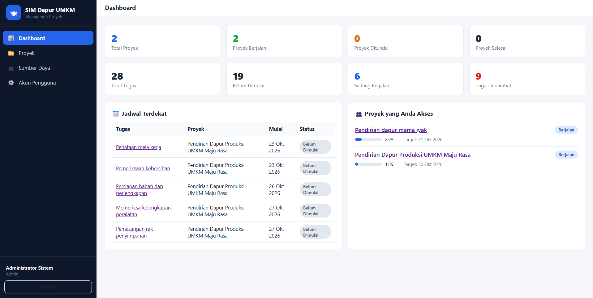
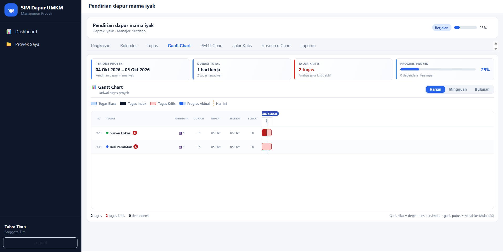

# SIM Proyek Dapur UMKM

Sistem Informasi Manajemen Proyek untuk persiapan pendirian dapur produksi UMKM. Aplikasi web berbasis **Express + better-sqlite3** dengan frontend vanilla JS (tanpa framework) yang mencakup manajemen proyek, tugas, anggota, sumber daya, hingga analisis visual proyek.

## Fitur

- **Proyek & anggota** — CRUD proyek, penambahan anggota, peran (admin / manajer / anggota) dengan kontrol akses.
- **Tugas & subtugas** — struktur tugas berjenjang (parent–child), status, progres aktivasi, penugasan sumber daya.
- **Jadwal & kalender kerja** — durasi hari kerja per kalender proyek (pengecualian hari libur di `src/calendar.js`).
- **Dependensi antartugas** — relasi Finish-to-Start (FS) & Start-to-Start (SS).
- **Analisis otomatis** (`src/scheduler.js`, `src/routes/analysis.js`):
  - forward/backward pass, **Early/Late Start & Finish**, **slack**,
  - deteksi **Jalur Kritis** (CPM),
  - **PERT** (E/O/P & te, network diagram),
  - **Gantt Chart**, **Kalender proyek**, **Resource chart/beban kerja**, **laporan**.
- **Gantt Chart profesional** (redesign):
  - Header ringkasan proyek: nama, periode, durasi hari kerja, jumlah tugas kritis, bar progres proyek.
  - Tabel tugas 7 kolom (ID, tugas, anggota, durasi, mulai, selesai, slack, %) dengan indentasi subtugas.
  - Timeline 3 tingkat (bulan → tanggal → hari) dengan skala **Harian / Mingguan / Bulanan**.
  - Batang jadwal konsisten: biasa / induk / kritis, dengan isi **progres aktual** dari data.
  - Garis dependensi SVG (FS penuh, SS putus-putus) di lapisan bawah agar tidak menutupi batang.
  - Penanda **Hari Ini** & **Rencana Selesai**, shading akhir pekan, garis batas bulan.
  - Scroll rapi: tabel kiri sticky, header sticky, baris selalu sejajar.

## Tampilan Aplikasi

### Tampilan 1 — Halaman Gantt Chart (skala harian)



### Tampilan 2 — Halaman Gantt Chart (tabel tugas & timeline)



## Persyaratan

- Node.js 18+
- npm

## Cara Menjalankan

```bash
# 1. Instal dependensi
npm install

# 2. (Opsional) Reset & isi database contoh
npm run seed

# 3. Jalankan aplikasi
npm start
```

Aplikasi berjalan di `http://localhost:3000` (ubah lewat env `PORT`).

## Akun Demo (hasil seed)

| Pengguna | Kata Sandi | Peran |
|---|---|---|
| `admin` | `admin123` | admin |
| `manajer` | `manajer123` | manager |
| `anggota` | `anggota123` | member |

> Akun demo hanya untuk data seed lokal — ubah sandi sebelum dipakai nyata.

## Uji

```bash
# Uji alur aplikasi (API end-to-end)
node scripts/flow-test.js

# Uji browser (halaman & regresi, butuh Chrome)
node scripts/browser-test.js

# Uji render & Gantt chart (audit posisi/pengguliran)
node scripts/gantt-test.js
node scripts/gantt-shot.js <label>   # simpan screenshot ke screenshots/
```

## Struktur Proyek

```
src/
  server.js          Entry point Express (+ static public/)
  db.js              Koneksi better-sqlite3
  schema.sql         Skema database
  seed.js            Seeder data contoh
  auth.js            Hash sandi & sesi
  calendar.js        Kalender hari kerja & pengecualian
  scheduler.js       Penjadwalan + CPM (forward/backward, slack, jalur kritis)
  routes/            auth, projects, users, resources, analysis
public/
  index.html         Halaman login
  app.html           Aplikasi utama (SPA tab)
  css/app.css        Gaya seluruh aplikasi (termasuk Gantt)
  js/                app, api, login, views (project, visual, more)
scripts/             Uji fungsional & renderer screenshot
```

## Nama Proyek

Mata kuliah: SIM — proyek "Pendirian Dapur Produksi UMKM Maju Rasa" (Bandung).
